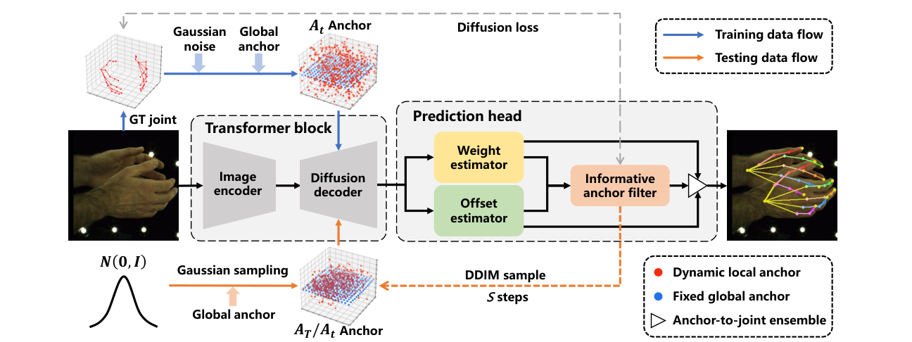

# DiffAnchor

### Anchor-Space Diffusion for Monocular 3D Hand Pose Estimation

**Accepted for Oral Presentation at IEEE Embodied AI.**

**Code is coming soon.**

Changlong Jiang, Youci Tang, Haohong Kuang, Hang Xu, Jinghong Zheng, Ran Wang, Zhenghong Yu, Chen Feng, Xiaofeng Yue, and Yang Xiao

## Overview

DiffAnchor estimates 3D hand pose from a single RGB or depth image. Instead of directly diffusing the final hand joints, it refines informative anchors with a few diffusion steps. Anchor-to-joint offset prediction and weighted aggregation then produce the final 3D joint locations.

*Method overview, cropped from Figure 2 of the paper. Fixed anchors provide spatial context, while dynamic anchors are refined through diffusion. Blue and orange arrows indicate training and testing data flow, respectively.*

## Code release

Code is coming soon. Please watch this repository for updates.

## Project QR code

Scan to open this repository:

